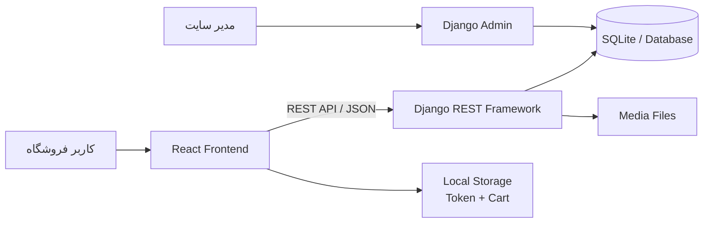
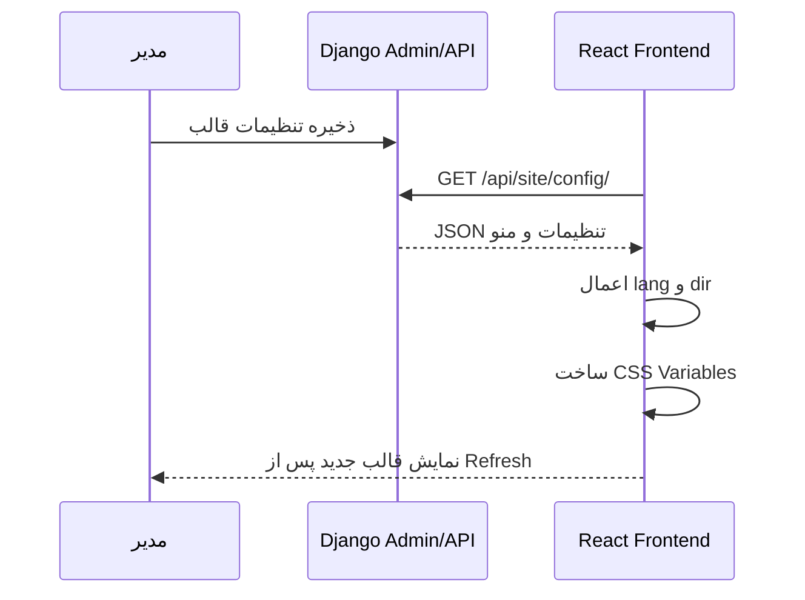

<div dir="rtl">

# مستند فنی و راهنمای ارائه پروژه فروشگاه اینترنتی

## ShoppingWeb — قالب فروشگاهی React با پنل مدیریت Django

**نوع پروژه:** فروشگاه اینترنتی و قالب مدیریت‌پذیر (Headless CMS)  
**فرانت‌اند:** React + Vite  
**بک‌اند:** Django + Django REST Framework  
**پایگاه داده فعلی:** SQLite  
**زبان رابط:** فارسی و انگلیسی  
**جهت رابط:** RTL و LTR

---

## ۱. چکیده پروژه

ShoppingWeb یک فروشگاه اینترنتی سریع و مدیریت‌پذیر است که ظاهر آن با React و API آن با Django REST Framework پیاده‌سازی شده است. هدف اصلی پروژه، ساخت قالبی شبیه قالب‌های آماده وردپرس است؛ با این تفاوت که رابط کاربری به‌صورت SPA و با React اجرا می‌شود و در نتیجه سرعت جابه‌جایی بین صفحات و تجربه کاربری بهتری دارد.

مدیر سایت می‌تواند بدون ویرایش کد، محصولات، دسته‌بندی‌ها، سفارش‌ها، کاربران، منوی سایت، رنگ‌ها، فونت، زبان، جهت نمایش، محتوای Hero و اطلاعات فوتر را از پنل Django Admin مدیریت کند.

---

## ۲. مسئله و راه‌حل

### مسئله

در بسیاری از فروشگاه‌های سنتی، ظاهر و محتوای سایت مستقیماً داخل کد قرار دارد. برای تغییر عنوان منو، رنگ قالب، متن صفحه اصلی یا اطلاعات تماس، معمولاً به برنامه‌نویس نیاز است. از طرف دیگر، قالب‌های آماده وردپرس مدیریت ساده‌ای دارند، اما ممکن است به دلیل افزونه‌های زیاد یا معماری یکپارچه، سنگین شوند.

### راه‌حل پروژه

در ShoppingWeb مدیریت محتوا و نمایش از هم جدا شده‌اند:

- Django مسئول اطلاعات، قوانین تجاری، احراز هویت، سفارش‌ها و پنل مدیریت است.
- React مسئول نمایش سریع، مسیریابی و تعامل کاربر است.
- ارتباط دو بخش از طریق REST API انجام می‌شود.
- تنظیمات قالب از پنل مدیریت دریافت و به CSS Variables تبدیل می‌شوند.
- برای اعمال تغییرات محتوایی و ظاهری نیازی به build مجدد فرانت نیست و refresh صفحه کافی است.

---

## ۳. معماری کلی سیستم



### معماری Headless

این پروژه از الگوی Headless استفاده می‌کند. بک‌اند HTML صفحه فروشگاه را تولید نمی‌کند؛ در عوض اطلاعات را به‌صورت JSON در اختیار React قرار می‌دهد. این معماری مزایای زیر را دارد:

- جداسازی کامل رابط کاربری از منطق سرور
- امکان ساخت اپلیکیشن موبایل با همان API
- توسعه مستقل فرانت و بک‌اند
- تجربه کاربری سریع‌تر
- قابلیت تغییر یا جایگزینی هر بخش بدون بازنویسی کل سیستم

---

## ۴. فناوری‌های استفاده‌شده

| بخش | فناوری | کاربرد |
|---|---|---|
| رابط کاربری | React 18 | ساخت کامپوننت‌ها و مدیریت state |
| ابزار توسعه | Vite 8 | اجرای dev server و production build سریع |
| مسیریابی | React Router 7 | مدیریت مسیرهای SPA و صفحات محافظت‌شده |
| درخواست HTTP | Axios | ارتباط فرانت با API |
| استایل | CSS Variables + Bootstrap | طراحی responsive و پوسته قابل تنظیم |
| اسلایدر | Swiper | نمایش تصاویر صفحه اصلی |
| اعلان‌ها | React Toastify | نمایش پیام‌های موفقیت و خطا |
| بک‌اند | Django 6 | مدل‌ها، پنل مدیریت و تنظیمات پروژه |
| API | Django REST Framework | ساخت endpointها و serializerها |
| فیلتر | django-filter | فیلتر محصولات بر اساس دسته و قیمت |
| احراز هویت | DRF Token Authentication | ورود و محافظت از APIهای خصوصی |
| تصاویر | Pillow | پردازش فیلدهای تصویری Django |
| دیتابیس | SQLite | دیتابیس محیط فعلی توسعه |

---

## ۵. قابلیت‌های اصلی

### امکانات عمومی فروشگاه

- نمایش محصولات فعال
- صفحه جزئیات محصول
- دسته‌بندی محصولات
- جست‌وجوی محصول
- فیلتر بر اساس دسته‌بندی
- فیلتر حداقل و حداکثر قیمت
- مرتب‌سازی بر اساس قیمت، نام، موجودی و زمان ایجاد
- صفحه‌بندی نتایج
- سبد خرید با قابلیت افزایش، کاهش و حذف کالا
- ذخیره سبد خرید در Local Storage
- طراحی responsive برای موبایل، تبلت و دسکتاپ

### حساب کاربری

- ثبت‌نام کاربر
- ورود با نام کاربری و رمز عبور
- دریافت و نگهداری Token
- مشاهده پروفایل
- خروج امن و حذف Token
- محافظت از صفحات checkout و سفارش‌ها
- انتقال کاربر به صفحه موردنظر بعد از ورود

### سفارش‌گذاری

- ثبت سفارش از روی اقلام سبد خرید
- دریافت مشخصات تحویل
- محاسبه مبلغ نهایی در سرور
- ذخیره قیمت محصول در زمان سفارش
- کنترل موجودی قبل از ثبت سفارش
- کسر موجودی به‌صورت تراکنشی
- جلوگیری از سفارش بیشتر از موجودی
- جلوگیری از ثبت محصول تکراری در اقلام سفارش
- نمایش تاریخچه سفارش‌های هر کاربر
- جلوگیری از مشاهده سفارش سایر کاربران

### پنل مدیریت

- مدیریت کاربران
- مدیریت محصولات و موجودی
- مدیریت دسته‌بندی‌ها
- مدیریت سفارش‌ها و وضعیت سفارش
- مشاهده اقلام هر سفارش
- مدیریت کامل ظاهر و محتوای اصلی قالب

---

## ۶. سیستم مدیریت قالب

مدل `SiteSettings` به‌صورت Singleton طراحی شده است؛ یعنی فقط یک رکورد تنظیمات اصلی برای کل سایت وجود دارد. این کار از ایجاد تنظیمات متناقض جلوگیری می‌کند.

### موارد قابل تغییر از پنل

- نام سایت
- لوگوی سایت
- زبان پیش‌فرض: فارسی یا انگلیسی
- جهت نمایش: RTL، LTR یا خودکار
- رنگ اصلی
- رنگ مکمل
- رنگ تأکیدی
- رنگ پس‌زمینه
- رنگ کارت‌ها
- رنگ متن اصلی و فرعی
- خانواده فونت
- میزان گردی گوشه‌ها
- حداکثر عرض محتوای سایت
- اعلان بالای Navbar
- عنوان، توضیحات، دکمه و تصویر Hero
- متن فوتر
- ایمیل، شماره تماس و نشانی

### مدیریت منوی Navbar

هر آیتم منو دارای اطلاعات زیر است:

- عنوان فارسی
- عنوان انگلیسی
- مسیر داخلی یا URL خارجی
- ترتیب نمایش
- وضعیت فعال یا غیرفعال
- بازشدن در تب جدید

### نحوه اعمال تنظیمات در React



---

## ۷. طراحی رابط کاربری

طراحی جدید پروژه بر اساس ویژگی‌های زیر انجام شده است:

- ظاهر مینیمال و مدرن
- استفاده از فضای سفید مناسب
- کارت‌های محصول با تصویر استاندارد و hover نرم
- Navbar شیشه‌ای با حالت موبایل
- Hero بزرگ با محتوای قابل مدیریت
- رنگ‌بندی مبتنی بر CSS Variables
- پشتیبانی کامل از راست‌چین و چپ‌چین
- استفاده از فونت IRANSansX در وزن‌های Light، Regular، Bold و Black
- Footer چندستونه و responsive
- صفحه محصول با تصویر بزرگ و اطلاعات خوانا
- کاهش وابستگی‌های سنگین و حذف MUI و React-Bootstrap از کد اجرایی

### اصلاح بخش Gallery

در نسخه قبلی، فیلترها با کلاس‌هایی مانند `w-75` و ساختار Flex نمایش داده می‌شدند و اندازه مناسبی نداشتند. ساختار جدید شامل موارد زیر است:

- ستون ثابت و دقیق ۲۸۰ پیکسلی برای فیلتر در دسکتاپ
- ستون منعطف برای محصولات
- حالت Sticky برای پنل فیلتر
- تبدیل خودکار به چیدمان تک‌ستونه در موبایل
- دسته‌بندی‌ها به‌شکل Chip
- ورودی‌های قیمت هم‌اندازه و responsive
- کارت محصولات با نسبت تصویر ثابت

---

## ۸. مدل‌های اصلی دیتابیس

### Category

- نام
- Slug یکتا
- توضیحات
- تصویر

### Product

- دسته‌بندی
- نام و Slug
- توضیحات
- قیمت
- موجودی
- تصویر
- وضعیت فعال یا غیرفعال
- تاریخ ایجاد و آخرین ویرایش

### Order

- کاربر ثبت‌کننده
- وضعیت سفارش
- نام و نام خانوادگی گیرنده
- تلفن
- نشانی و کد پستی
- توضیحات
- مبلغ کل
- تاریخ ثبت و ویرایش

### OrderItem

- سفارش
- محصول
- نام محصول در زمان خرید
- قیمت واحد در زمان خرید
- تعداد
- مبلغ جزء

ذخیره نام و قیمت محصول داخل OrderItem باعث می‌شود تغییر قیمت یا نام محصول در آینده، اطلاعات تاریخی سفارش را خراب نکند.

### SiteSettings

- تنظیمات برند
- تنظیمات زبان و جهت
- رنگ‌ها و فونت
- تنظیمات layout
- محتوای Hero
- اطلاعات فوتر و تماس

### NavigationItem

- عنوان فارسی و انگلیسی
- URL
- ترتیب
- وضعیت نمایش
- حالت بازشدن لینک

---

## ۹. APIهای اصلی

### محصولات

| Method | Endpoint | توضیح | دسترسی |
|---|---|---|---|
| GET | `/api/products/` | فهرست و فیلتر محصولات | عمومی |
| POST | `/api/products/` | ساخت محصول | فقط Staff |
| GET | `/api/products/categories/` | فهرست دسته‌ها | عمومی |
| GET | `/api/products/<slug>/` | جزئیات محصول | عمومی |
| PUT/PATCH | `/api/products/<slug>/` | ویرایش محصول | فقط Staff |
| DELETE | `/api/products/<slug>/` | حذف محصول | فقط Staff |

پارامترهای قابل استفاده برای محصولات:

```text
?search=chair
?category=chairs
?min_price=100000
?max_price=5000000
?ordering=price
?ordering=-created_at
?page=2
```

### احراز هویت

| Method | Endpoint | توضیح |
|---|---|---|
| POST | `/api/auth/register/` | ثبت‌نام |
| POST | `/api/auth/login/` | ورود و دریافت Token |
| GET | `/api/auth/profile/` | اطلاعات کاربر جاری |
| POST | `/api/auth/logout/` | خروج و حذف Token |

هدر درخواست‌های محافظت‌شده:

```http
Authorization: Token <user-token>
```

### سفارش‌ها

| Method | Endpoint | توضیح |
|---|---|---|
| GET | `/api/orders/` | سفارش‌های کاربر جاری |
| POST | `/api/orders/` | ثبت سفارش |
| GET | `/api/orders/<id>/` | جزئیات سفارش متعلق به کاربر |

نمونه درخواست ثبت سفارش:

```json
{
  "first_name": "سروش",
  "last_name": "مرادی",
  "phone": "09120000000",
  "address": "تهران، خیابان نمونه",
  "postal_code": "1234567890",
  "notes": "تحویل در ساعات اداری",
  "line_items": [
    {
      "product_id": 1,
      "quantity": 2
    }
  ]
}
```

### تنظیمات قالب

| Method | Endpoint | توضیح |
|---|---|---|
| GET | `/api/site/config/` | دریافت تنظیمات پوسته و منو |

---

## ۱۰. امنیت

اقدامات امنیتی انجام‌شده:

- رمزهای عبور توسط سیستم استاندارد Django Hash می‌شوند.
- Token فقط برای APIهای نیازمند ورود استفاده می‌شود.
- کاربران ناشناس فقط امکان خواندن محصولات را دارند.
- فقط کاربران Staff امکان ساخت، ویرایش و حذف محصول دارند.
- هر کاربر فقط سفارش‌های متعلق به خودش را مشاهده می‌کند.
- موجودی و مبلغ سفارش در سرور بررسی می‌شوند و به اطلاعات فرانت اعتماد نمی‌شود.
- ثبت سفارش داخل Database Transaction انجام می‌شود.
- تنظیمات حساس production از Environment Variable خوانده می‌شوند.
- تنظیمات HTTPS، Cookie امن و HSTS برای حالت production آماده شده‌اند.
- `npm audit` در آخرین بررسی، صفر آسیب‌پذیری گزارش کرده است.

متغیرهای مهم production در فایل `backend/.env.example` مستند شده‌اند.

---

## ۱۱. تست و کنترل کیفیت

پروژه دارای تست‌هایی برای بخش‌های زیر است:

- ثبت‌نام، ورود، پروفایل و خروج
- دسترسی عمومی به محصولات
- جلوگیری از ایجاد محصول توسط کاربر ناشناس
- جلوگیری از ایجاد محصول توسط کاربر عادی
- امکان ایجاد محصول توسط Staff
- نیاز به احراز هویت برای سفارش‌ها
- محاسبه مبلغ سفارش
- کاهش موجودی
- جلوگیری از سفارش بیشتر از موجودی
- جلوگیری از اقلام تکراری
- محدودکردن مشاهده سفارش‌ها به مالک آن‌ها
- تنظیمات Singleton سایت
- API عمومی و چندزبانه تنظیمات قالب

دستورهای کنترل کیفیت:

```powershell
# تست بک‌اند
cd backend
.\.venv\Scripts\python.exe manage.py test

# بررسی Django
.\.venv\Scripts\python.exe manage.py check

# بررسی فرانت
cd ..
npm run lint
npm run build
npm audit
```

نتیجه آخرین بررسی:

- Django check: موفق
- تست‌های بک‌اند: موفق
- ESLint: بدون خطا
- Production build: موفق
- npm audit: صفر آسیب‌پذیری

---

## ۱۲. ساختار مهم پروژه

```text
shoppingWeb/
├── backend/
│   ├── accounts/          # ثبت‌نام، ورود، پروفایل و خروج
│   ├── core/              # تنظیمات قالب و منوی سایت
│   ├── orders/            # سفارش و اقلام سفارش
│   ├── products/          # محصولات، دسته‌ها، فیلتر و صفحه‌بندی
│   ├── config/            # تنظیمات اصلی Django
│   ├── media/             # تصاویر آپلودشده
│   ├── db.sqlite3
│   └── manage.py
├── src/
│   ├── api/               # Axios و مدیریت خطا
│   ├── context/           # احراز هویت و تنظیمات قالب
│   ├── components/
│   │   ├── auth/
│   │   ├── category/
│   │   ├── checkout/
│   │   ├── footer/
│   │   ├── gallery/
│   │   ├── header/
│   │   ├── orders/
│   │   ├── products/
│   │   └── ShoppingCard/
│   ├── assets/woff2/      # فونت IRANSansX
│   ├── App.jsx
│   └── main.jsx
├── public/                # تصاویر عمومی
├── docs/                  # مستندات پروژه
├── package.json
└── README.md
```

---

## ۱۳. راه‌اندازی پروژه

### اجرای بک‌اند

```powershell
cd D:\project\shoppingWeb\backend
.\.venv\Scripts\python.exe manage.py migrate
.\.venv\Scripts\python.exe manage.py runserver
```

آدرس‌ها:

```text
API:   http://127.0.0.1:8000/
Admin: http://127.0.0.1:8000/admin/
```

در صورت نیاز به ساخت مدیر جدید:

```powershell
.\.venv\Scripts\python.exe manage.py createsuperuser
```

### اجرای فرانت‌اند

```powershell
cd D:\project\shoppingWeb
npm install
npm run dev
```

آدرس فرانت:

```text
http://127.0.0.1:5173/
```

فایل `.env` فرانت:

```env
VITE_API_BASE_URL=http://127.0.0.1:8000
```

---

## ۱۴. سناریوی پیشنهادی برای ارائه حضوری

### مرحله اول: معرفی — حدود ۱ دقیقه

«این پروژه یک فروشگاه اینترنتی Headless است. رابط کاربری با React و بک‌اند با Django ساخته شده است. هدف پروژه ترکیب سرعت React با مدیریت ساده‌ای شبیه قالب‌های وردپرس بوده است.»

### مرحله دوم: نمایش فروشگاه — حدود ۲ دقیقه

1. صفحه اصلی و Hero را نمایش دهید.
2. responsive بودن Navbar را توضیح دهید.
3. وارد Gallery شوید.
4. دسته‌بندی، قیمت، مرتب‌سازی و جست‌وجو را امتحان کنید.
5. صفحه جزئیات یک محصول را باز کنید.

### مرحله سوم: خرید — حدود ۲ دقیقه

1. یک محصول را به سبد اضافه کنید.
2. تعداد را تغییر دهید.
3. وارد checkout شوید.
4. ورود یا ثبت‌نام را نمایش دهید.
5. سفارش را ثبت کنید.
6. کاهش موجودی و نمایش سفارش در تاریخچه را نشان دهید.

### مرحله چهارم: CMS — حدود ۳ دقیقه

1. وارد Django Admin شوید.
2. در «تنظیمات سایت» رنگ اصلی یا عنوان Hero را تغییر دهید.
3. در «منوی ناوبری» نام یک آیتم را تغییر دهید.
4. فرانت را refresh کنید و اعمال فوری تغییرات را نمایش دهید.
5. زبان را از فارسی به انگلیسی تغییر دهید و تغییر خودکار Direction را نشان دهید.

### مرحله پنجم: معماری و امنیت — حدود ۲ دقیقه

1. توضیح دهید که فرانت و بک‌اند از طریق REST API متصل‌اند.
2. Token Authentication را توضیح دهید.
3. کنترل موجودی و Transaction سفارش را توضیح دهید.
4. به تست‌ها، lint، build و audit بدون آسیب‌پذیری اشاره کنید.

---

## ۱۵. نقاط قوت پروژه

- معماری تمیز و قابل توسعه
- پنل مدیریت بدون نیاز به ساخت داشبورد جداگانه
- پوسته قابل شخصی‌سازی بدون ویرایش کد
- پشتیبانی از فارسی، انگلیسی، RTL و LTR
- طراحی مدرن و responsive
- محاسبه امن سفارش در بک‌اند
- کنترل سطح دسترسی
- قابلیت استفاده مجدد به‌عنوان قالب فروشگاهی
- آماده برای مهاجرت از SQLite به PostgreSQL
- امکان توسعه اپلیکیشن موبایل بر پایه همان API

---

## ۱۶. توسعه‌های پیشنهادی آینده

- اتصال درگاه پرداخت واقعی
- افزودن کد تخفیف
- روش‌های مختلف ارسال
- ثبت و مدیریت نظر کاربران
- امتیازدهی واقعی محصولات
- علاقه‌مندی‌ها
- بازیابی رمز عبور با ایمیل
- تأیید ایمیل و شماره موبایل
- آپلود چند تصویر برای هر محصول
- مدیریت اسلایدر از پنل
- ثبت پیام‌های تماس و اعضای خبرنامه
- داشبورد آماری فروش
- استفاده از PostgreSQL در production
- ذخیره فایل‌ها در Object Storage
- Docker و CI/CD
- تست‌های End-to-End

---

## ۱۷. جمع‌بندی

ShoppingWeb فقط یک رابط فروشگاه نیست؛ یک سیستم فروشگاهی مدیریت‌پذیر با معماری Headless است. React تجربه کاربری سریع و مدرن را فراهم می‌کند و Django مسئول امنیت، داده‌ها، سفارش‌ها و مدیریت محتوا است. سیستم پوسته داینامیک نیز باعث شده مدیر سایت بتواند مهم‌ترین بخش‌های ظاهری و محتوایی را بدون تغییر کد کنترل کند.

این معماری پایه مناسبی برای تبدیل پروژه به محصول واقعی، قالب قابل فروش یا فروشگاه production محسوب می‌شود.

</div>
